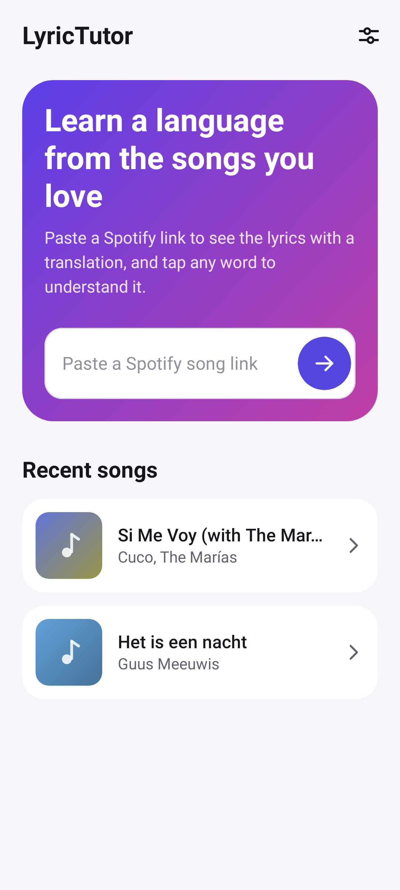
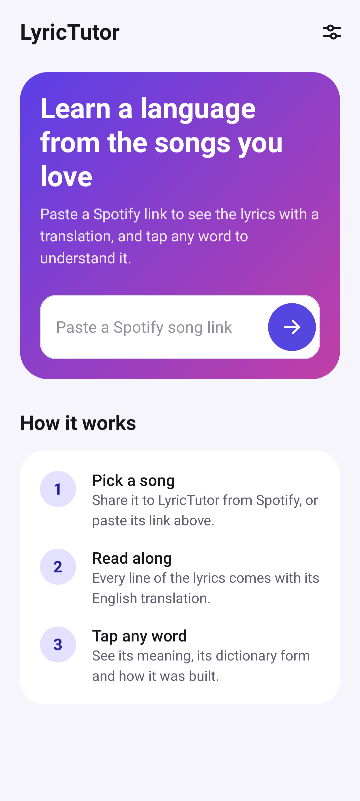
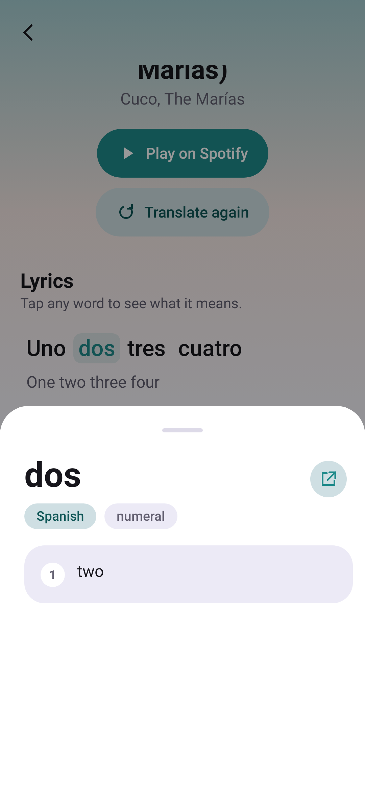
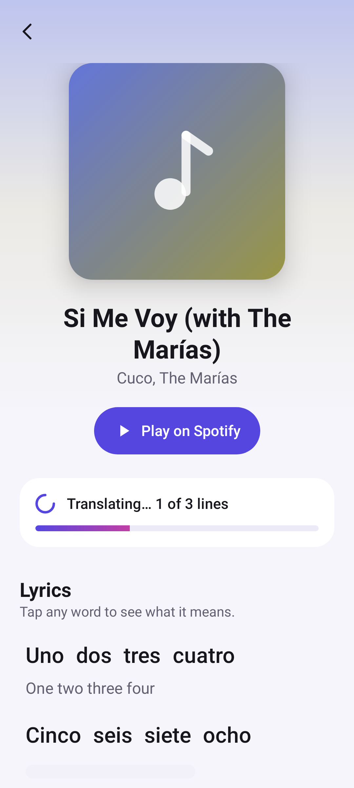
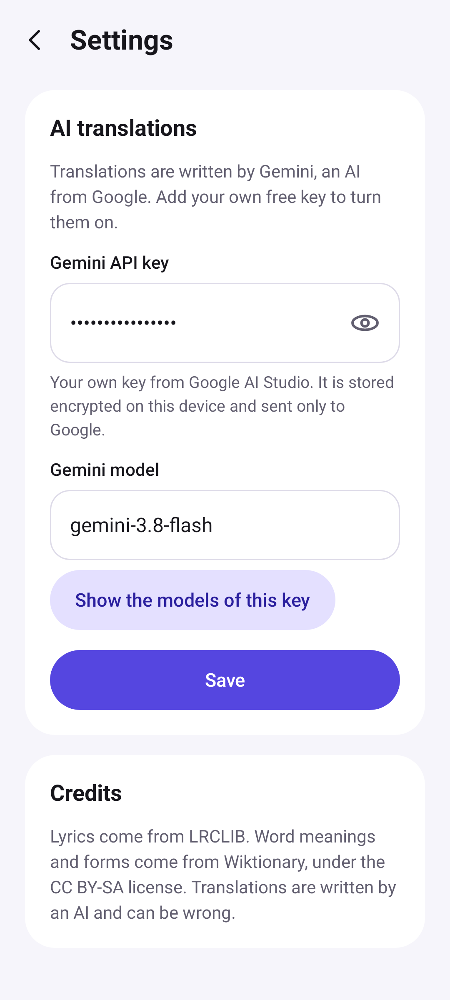

<!-- Generated from readme.yml by LukeNeedham/ci-workflows (docs/readme.md). Edit readme.yml, not this file. -->
<p align="center">
  
</p>

# LyricTutor

Learn a language from the songs you listen to.

## Description

LyricTutor turns a Spotify song into a language lesson. Paste a song link, or share it to the app from Spotify, and it reads
the song's details and shows the lyrics line by line with an English translation. Tap any word to see what it means in
context, its dictionary form and how it was conjugated, and where it comes from, with English cognates to help it stick.

It works with any language, and is built for real songs: slang, elisions and lines that mix languages. It is a personal app:
lyrics are fetched on demand and are never stored in the app's code or shared.

## Screenshots







## Getting started as a user

1. Install the latest build from the [AppHub](https://www.lukeneedham.com/apphub) app, or download the APK from the [Releases](https://github.com/LukeNeedham/LyricTutor/releases) page.

Requires Android 6.0 (API 23) or newer.

## Getting started as a developer

Requirements: JDK 17 and the Android SDK (platform 36), for example through Android Studio.

```
git clone https://github.com/LukeNeedham/LyricTutor.git
cd LyricTutor
./gradlew assembleDebug    # the APK is in app/build/outputs/apk/debug/
./gradlew test             # unit tests
```

Every pull request is built by CI, which comments on it with a link to install the APK.

Like all my apps, it follows the shared architecture and conventions (single activity, Jetpack Compose, Navigation 3, MVVM with every page split into a `Page` and a `PageContent`, Koin): see [ci-workflows](https://github.com/LukeNeedham/ci-workflows/blob/main/docs/new-app.md).

## Contributing

Branch from `main`, make the change, and open a pull request. CI must be green before it is merged.

## License

All rights reserved. See [LICENSE](LICENSE).
